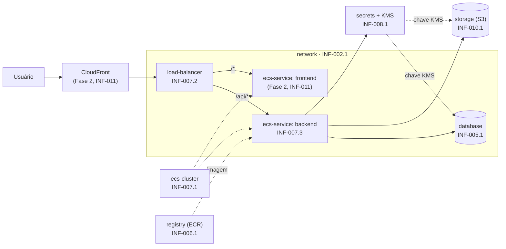

# Mapa dos módulos

Quem faz o quê está nos cards do GitHub Project (Fase 1: estruturação Terraform). Este
documento mostra **como as peças se encaixam**, para cada pessoa saber de quem recebe dados
e para quem entrega.

## Arquitetura alvo



## Módulos da Fase 1

| Módulo | Card | Recebe de | Entrega para |
| --- | --- | --- | --- |
| `network` | INF-002.1 | nada | todos (VPC, subnets, SGs) |
| `secrets` | INF-008.1 | nada | database, storage, registry, ecs-service (chave KMS, ARNs) |
| `database` | INF-005.1 | network, secrets | ecs-service (endpoint, ARN do segredo) |
| `registry` | INF-006.1 | secrets (opcional) | CI (INF-009), ecs-service (URL da imagem) |
| `storage` | INF-010.1 | secrets | ecs-service (nome do bucket) |
| `ecs-cluster` | INF-007.1 | nada | ecs-service |
| `load-balancer` | INF-007.2 | network | ecs-service (listener), CloudFront |
| `ecs-service` | INF-007.3 | todos acima | alarmes (INF-013), deploy (INF-009) |
| `global/github-oidc` | INF-004.1 | registry (ARNs) | CI (roles) |

## Por que dá para trabalhar em paralelo

1. **O contrato já existe.** `variables.tf` e `outputs.tf` de cada módulo foram definidos na
   estrutura base. Você implementa o `main.tf` e troca os `null` dos outputs pela referência
   real. Não renomeie entradas nem saídas sem combinar com quem consome.
2. **Fixtures substituem o módulo do colega.** Para testar o `database` não é preciso esperar o
   `network`: o teste usa `tests/fixtures/rede-minima`, que tem os mesmos outputs. O mesmo vale
   para `kms-minima` (no lugar do `secrets`) e `entrada-minima` (cluster + ALB).
3. **Um arquivo por módulo nos roots.** Cada pessoa descomenta só o próprio arquivo em
   `environments/development/` e `environments/production/`. Não há conflito de merge.

## Ordem de integração nos roots

O módulo pode ser feito e testado em qualquer ordem. Só o passo de **descomentar o bloco no
root** precisa que as dependências já estejam na `main`:

```text
1. network, secrets, ecs-cluster, registry   (não dependem de ninguém)
2. database, storage, load-balancer          (dependem de network e/ou secrets)
3. ecs-service (backend)                     (depende de todos)
```

Se a dependência ainda não entrou, abra o PR com o módulo e o teste; o root fica para um PR
pequeno depois.

## Fase 2 (depois que a Fase 1 fechar)

- CDN/CloudFront e runtime do frontend (INF-011, depende do ADR-010).
- Observabilidade: log groups, alarmes e SNS (INF-012, INF-013).
- Backup e retenções (INF-015).
- Aplicação real em produção: depende da conta AWS e do bootstrap do state (INF-001).
